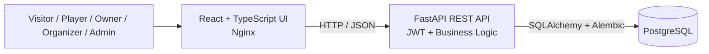

> **Integration status:** This repository is being integrated from the existing DatSan prototype. The Sprint 2 candidate exposes accounts, sports, courts, reservations, simulated payments and notifications. Team/tournament and full Admin features are planned for Sprint 3; the combined migration already includes their tables. The full-project descriptions below are target scope, not acceptance evidence. See [SDD](specs/README.md) and [Sprint 2 integration](docs/sdd/SPRINT_2_INTEGRATION.md). Verify Docker, PostgreSQL and browser tests locally before claiming completion.

# DatSân — Sports Booking & Amateur Tournament Management System

**DatSân** is a full-stack web application developed as a Software Engineering course project. It brings together sports facility discovery and reservation, facility-owner operations, and amateur tournament management in a single role-based platform.

The repository contains the React user interface, FastAPI REST backend, PostgreSQL database schema, database migrations, automated tests, Docker configuration, and sample data for demonstration.

> **Project scope:** An educational, locally deployable demonstration. Payments are simulated and do **not** transfer real money. The included venues, users, and bookings are fictional sample data. This version is not production-ready.

## 1. Project objectives

- Help players find sports facilities and reserve available time slots.
- Give facility owners tools to manage courts, operating hours, maintenance periods, and booking approvals.
- Enable organizers to manage teams, tournament registration, fixtures, match scheduling, scores, and standings.
- Provide administrators with basic system monitoring and user-management capabilities.
- Prevent conflicting reservations, including conflicts between ordinary bookings and scheduled tournament matches.

## 2. User roles and web features

| Role | Main web features |
| --- | --- |
| **Visitor** | Browse and filter courts by sport, district, name, and price; view court details, operating hours, available time slots, tournaments, match schedules, and standings. |
| **Player** | Register and sign in; reserve a court; review, reschedule, or cancel eligible bookings; submit a **simulated** payment reference; create teams and manage team members; register teams for tournaments; read in-app notifications. |
| **Facility owner** | Create, update, or deactivate courts; configure operating hours and maintenance periods; review, approve, reject, or cancel bookings; manually confirm simulated payments. |
| **Tournament organizer** | Create and manage tournaments; review team registrations; generate round-robin or knockout fixtures; assign courts and match times; record results; view standings. |
| **Administrator** | View an overview dashboard, activate/deactivate users, maintain the sports catalog, and access authorized administrative operations. |

### Main pages

| Page / route | Purpose |
| --- | --- |
| `/` | Court search and filtering |
| `/courts/:id` | Court information, availability, and booking entry point |
| `/login`, `/register` | Authentication |
| `/bookings` | Player booking history and booking actions |
| `/teams` | Team and member management |
| `/tournaments`, `/tournaments/:id` | Tournament directory, fixtures, registrations, and standings |
| `/owner`, `/owner/bookings` | Owner court management and booking review |
| `/organizer` | Tournament administration |
| `/notifications` | In-app notifications |
| `/admin` | Administrator dashboard and user controls |

Navigation and API access are restricted according to the authenticated user's role.

## 3. Technology stack

| Layer | Technologies | Responsibilities |
| --- | --- | --- |
| **Frontend** | React 18, TypeScript, Vite, React Router, CSS, Lucide icons | User interface, navigation, forms, role-specific pages, API consumption |
| **Backend** | Python, FastAPI, Pydantic, SQLAlchemy | REST API, validation, authorization, business rules, scheduling logic |
| **Authentication** | JWT bearer tokens and password hashing | Login, user identity, role-based access control |
| **Database** | PostgreSQL 16, Alembic | Relational data, migrations, transaction safety, scheduling constraints |
| **Deployment** | Docker, Docker Compose, Nginx | Reproducible local stack; static frontend served by Nginx |
| **Quality assurance** | pytest, FastAPI TestClient, GitHub Actions, concurrency-test script | API regression tests, build checks, overlapping-booking verification |

### System architecture



The browser communicates with FastAPI through JSON endpoints. Only the backend accesses the database; the frontend does not contain PostgreSQL credentials.

## 4. Core business workflows

### Court reservation

1. A visitor searches for a court and checks availability for a selected date and duration.
2. An authenticated player submits a booking request. A new `PENDING` booking immediately reserves the slot.
3. The facility owner approves or rejects the request. Rejected and cancelled reservations release their occupied slots.
4. The player may submit a **demo-only** payment reference, which the owner can mark as verified.
5. Eligible bookings can be rescheduled or cancelled according to the implemented rules.

**Conflict prevention:** Court occupancy is represented in `court_allocations`. PostgreSQL uses a GiST exclusion constraint on overlapping timestamp ranges for the same court. This database-level protection is designed to prevent concurrent requests from creating overlapping active allocations. Tournament matches use the same occupancy mechanism. The API returns `409 Conflict` for booking conflicts.

### Tournament management

1. An organizer creates a tournament and chooses a supported format.
2. Players create teams and submit tournament registrations.
3. The organizer reviews registrations and generates fixtures from approved teams.
4. Matches are assigned to compatible courts and available time slots.
5. Results update standings for round-robin competitions; knockout competitions can generate the next round when the current round is completed.

**Supported formats:** Single round-robin and single-elimination knockout tournaments (supported knockout sizes: 2, 4, 8, 16, or 32 approved teams). Advanced formats such as group stages followed by playoffs are outside the current scope.

## 5. Database design

The database schema evolved through three development stages:

- **Foundation:** `users`, `sports`, `courts`, `operating_hours`, `maintenance_windows`.
- **Booking:** `bookings`, `payments`, `notifications`, `court_allocations`.
- **Tournament:** `teams`, `team_members`, `tournaments`, `tournament_registrations`, `matches`.

Schema changes are managed through Alembic migrations (`0001_initial` and `0002_complete`). See [`docs/ERD_FULL.md`](docs/ERD_FULL.md) for the entity-relationship diagram and database constraints.

## 6. Repository structure

```text
DatSan_Fullstack/
├── backend/
│   ├── app/
│   │   ├── api/               # Auth, courts, sports, bookings, teams/tournaments, admin
│   │   ├── core/              # Configuration and security
│   │   ├── db/                # SQLAlchemy base and database sessions
│   │   ├── services/          # Court and match scheduling logic
│   │   ├── models.py          # ORM entities
│   │   ├── schemas.py         # Request/response schemas
│   │   ├── seed.py            # Idempotent development sample data
│   │   └── main.py            # FastAPI application and router registration
│   ├── alembic/versions/      # Database migrations
│   ├── tests/                 # Backend tests
│   ├── entrypoint.sh          # Migrate, seed, then start the API
│   └── Dockerfile
├── frontend/
│   ├── src/
│   │   ├── pages/             # Role-based application pages
│   │   ├── components/        # Shared layout and UI components
│   │   ├── api.ts             # HTTP API client
│   │   ├── auth.tsx           # Authentication context
│   │   ├── types.ts           # TypeScript data types
│   │   ├── App.tsx            # Application routes
│   │   └── styles.css         # Application styling
│   ├── nginx.conf
│   └── Dockerfile
├── docs/                      # ERD, API reference, QA, limitations, test notes
├── postman/                   # API request collection
├── scripts/                   # PostgreSQL concurrency-test utility
├── .github/workflows/ci.yml  # Backend and frontend CI checks
├── compose.yaml              # Local multi-container environment
├── .env.example              # Development configuration template
└── README.md
```

## 7. Demo data and accounts

When `APP_ENV=development` and `SEED_DEMO_DATA=true`, the backend seeds a new database with example records. The seed operation is designed to be repeatable without duplicating its existing demo records.

| Sample data | Initial count |
| --- | ---: |
| Accounts across four roles | 7 |
| Sports | 6 |
| Courts (sample Hanoi locations) | 12 |
| Bookings | 8 |
| Teams | 6 |
| Tournaments | 2 |
| Matches | 6 |

**Development-only demo credentials:**

| Role | Email | Password |
| --- | --- | --- |
| Player | `player@demo.example.com` | `Demo123!` |
| Facility owner | `owner@demo.example.com` | `Demo123!` |
| Tournament organizer | `organizer@demo.example.com` | `Demo123!` |
| Administrator | `admin@demo.example.com` | `Demo123!` |

Additional demo users are defined in `backend/app/seed.py`. **Do not use these accounts or passwords in a public deployment.**

## 8. Run locally with Docker

**Prerequisites:** Docker Engine/Desktop and Docker Compose.

Create a local environment file from the template, then start the application:

```bash
# Linux / macOS
cp -n .env.example .env

docker compose up --build -d
docker compose ps
```

On Windows PowerShell, use `Copy-Item .env.example .env` instead of `cp -n`.

| Service | Local address |
| --- | --- |
| Web application | `http://localhost:5173` |
| Interactive API documentation | `http://localhost:8000/docs` |
| API health check | `http://localhost:8000/api/health` |
| PostgreSQL (local development tools) | `localhost:5433` |

The default development database name and user are both `datsan`. The database password is configured through `POSTGRES_PASSWORD` in the untracked `.env` file. The backend uses the internal Docker address `db:5432`.

To stop the local stack while preserving the database volume:

```bash
docker compose down
```

**Warning:** `docker compose down -v` removes the project's PostgreSQL volume and can permanently delete local data.

## 9. API and testing

The backend exposes JSON REST endpoints under `/api`. Major endpoint groups include:

- `/api/auth` — registration, login, current user.
- `/api/sports` and `/api/courts` — catalog, court management, operating hours, maintenance, availability.
- `/api/bookings` — booking lifecycle and simulated payment confirmation.
- `/api/notifications` — in-app notifications.
- `/api/teams` and `/api/tournaments` — teams, registrations, fixtures, scheduling, scores, standings.
- `/api/admin` — administrative overview and user controls.

See [`docs/API_REFERENCE.md`](docs/API_REFERENCE.md) or the interactive Swagger page for individual endpoints.

**Backend tests** (from the `backend` directory, with Python dependencies installed):

```bash
pip install -r requirements-dev.txt
pytest -q
```

**PostgreSQL concurrency check** (with the local Docker stack running, from the repository root):

```bash
python scripts/verify_pg_concurrency.py --court 1 --workers 50
```

The script creates test data in the local development database. It expects one successful booking and conflicting requests to be rejected when the selected slot is initially available. The included automated backend tests use SQLite for isolated API tests; the separate PostgreSQL test is needed to verify database-specific concurrency behavior.

The repository also contains a GitHub Actions workflow for backend tests, migration checks, and a frontend build.

## 10. Documentation

| Document | Contents |
| --- | --- |
| [`docs/ERD_FULL.md`](docs/ERD_FULL.md) | Data model and constraints |
| [`docs/API_REFERENCE.md`](docs/API_REFERENCE.md) | REST endpoints and business flows |
| [`docs/DEMO_AND_QA.md`](docs/DEMO_AND_QA.md) | Demo scenarios and acceptance testing |
| [`docs/TEST_RESULTS.md`](docs/TEST_RESULTS.md) | Recorded verification and remaining checks |
| [`docs/LIMITATIONS_AND_DEPLOY.md`](docs/LIMITATIONS_AND_DEPLOY.md) | Current limitations and deployment considerations |
| [`docs/POSTGRES_DEMO_QUERIES.sql`](docs/POSTGRES_DEMO_QUERIES.sql) | Example SQL queries for inspecting demo data |

## 11. Limitations and project status

This repository is intended for academic demonstration and local testing. It does **not** integrate a real payment gateway, bank verification, automated refunds, external email/SMS notifications, verified facility-provider data, or production-grade authentication hardening. The sample locations are fictional and should not be interpreted as live facility availability.

The project includes backend tests, a PostgreSQL concurrency-check script, and a Docker Compose setup. A successful container build/start has been observed on a development Ubuntu machine; **complete browser-based acceptance testing, PostgreSQL concurrency verification, and security review are still required before any production deployment**.

---

**Course project:** Software Engineering · **Team size:** 6 contributors · **Application:** DatSân
