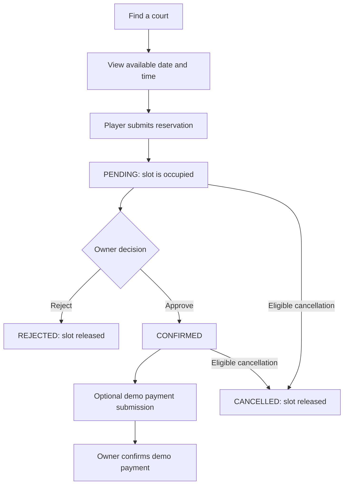

# Features and User Workflows

## 1. Intended users

| User | Supported capabilities |
| --- | --- |
| Visitor | Browse sports and courts; search/filter by keyword, sport, district, and price; view court availability and public tournaments |
| Player | Register/login; create and manage eligible bookings; submit demo payment references; manage teams; enter tournaments; read notifications |
| Facility owner | Create/update/deactivate owned courts; manage opening hours and maintenance; review/approve/reject bookings; confirm demo payments |
| Tournament organizer | Create tournaments; review team applications; generate fixtures; schedule matches; record results; inspect standings |
| Administrator | View system totals; activate/deactivate users; manage the sports catalog; access selected administrative workflows |

A user has one account role (`PLAYER`, `OWNER`, `ORGANIZER`, or `ADMIN`). Public registration offers `PLAYER` and `OWNER` only. Organizer and administrator accounts are provided as seeded demo users; there is no public role-upgrade workflow.

## 2. Website pages

The following routes are defined in `frontend/src/App.tsx`.

| Route | Audience | Page functions |
| --- | --- | --- |
| `/` | Public | Search and filter available courts |
| `/courts/:id` | Public / booking requires login | Court details, operating hours, available time slots, booking entry point |
| `/login`, `/register` | Public | Sign in or create an eligible account |
| `/bookings` | Player, Admin | List personal bookings; reschedule/cancel; submit demo payment reference |
| `/teams` | Signed-in users | Create teams and manage their members |
| `/tournaments` | Public | Tournament directory |
| `/tournaments/:id` | Public; restricted actions | Details, registrations, matches, standings, and role-dependent actions |
| `/owner` | Owner, Admin | Manage owned courts, operating hours, and maintenance |
| `/owner/bookings` | Owner, Admin | Review booking requests and demo payment status |
| `/organizer` | Organizer, Admin | Tournament administration and match management |
| `/notifications` | Signed-in users | Review and mark in-app notifications as read |
| `/admin` | Admin | Summary dashboard, users, and administrative actions |

The interface is primarily localized in Vietnamese. Technical documentation is in English for academic review.

## 3. Court discovery and reservation

**Key rules:**

- New bookings require authentication as a player or administrator.
- The selected time must be in the future, within the court's local opening hours, and on a single local calendar day.
- Duration must meet the court minimum, use 30-minute increments, and not exceed four hours.
- Maintenance windows and existing active allocations block a time slot. Court-specific buffer minutes extend the occupied period.
- A `PENDING` request reserves its slot immediately. Owner approval changes it to `CONFIRMED` without creating a second allocation.
- Rejection or cancellation deactivates the allocation. Rescheduling resets an eligible booking to `PENDING` for approval again.
- Rescheduling is not allowed once a demo payment has been submitted or marked paid.
- The API returns `409 Conflict` for an occupied time slot. The database additionally enforces the no-overlap constraint on PostgreSQL.

### Simulated payments

A confirmed booking can receive a payment reference submitted by its player (`UNPAID` → `SUBMITTED`). Its facility owner may manually mark it `PAID`. **This is a simulation only:** no bank integration, money transfer, payment gateway, or automatic refund is implemented. Cancellation of a booking with a submitted/paid reference marks the payment `REFUND_REVIEW` for manual follow-up.

## 4. Facility management

Owners can add courts, edit names/addresses/prices and sports, activate/deactivate listings, configure one opening interval per weekday, and create/remove maintenance periods. The backend prevents changes to operating hours or maintenance periods that would invalidate active future court allocations.

## 5. Teams and tournaments

1. An authenticated user creates a team and manages its member list.
2. A tournament organizer creates an event for a sport, chooses `ROUND_ROBIN` or `KNOCKOUT`, defines dates and team capacity, and opens registration.
3. A team captain applies to an open tournament. The organizer approves or rejects each application.
4. The organizer generates fixtures from approved teams. At least two approved teams are required.
5. The organizer assigns compatible courts and times within the tournament period. Scheduling checks existing bookings/matches and prevents the same team from playing two simultaneous matches within the tournament.
6. The organizer records scores. Round-robin standings use 3 points for a win, 1 for a draw, 0 for a loss, with goal difference and goals scored as tie-breakers. In knockout events, the next round is created after all current-round matches are finished.

**Knockout limitation:** the approved team count must be a power of two (2, 4, 8, 16, or 32). Knockout results cannot be draws; the organizer must enter a decisive score. Group-stage and seeded bracket features are not included.

## 6. Notifications and administration

Notifications are stored in PostgreSQL and displayed in the application; there is no email, SMS, or push delivery. Administrators can view basic totals and enable/disable user accounts. The dashboard's demo paid amount is **not actual revenue**.

## 7. What the demonstration does not provide

Real-money payments, verified real-world court inventory, public organizer/admin sign-up, map/geolocation discovery, image uploads, password reset, and production-grade account security are outside the current implementation. See [Limitations and deployment](LIMITATIONS_AND_DEPLOY.md).
