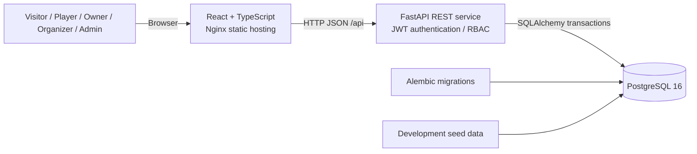

# System Architecture

## 1. Architectural overview

DatSan follows a three-tier web architecture: a React browser application, a FastAPI service, and a PostgreSQL database. Docker Compose starts the components on a shared private container network.



**Design rule:** Browser code communicates with the REST API; it never connects directly to PostgreSQL or receives database credentials.

## 2. Technology and responsibilities

| Layer | Technology | Responsibilities |
| --- | --- | --- |
| Web client | React, TypeScript, React Router, Vite | Search, forms, navigation, role-aware pages, rendering API results |
| Web server | Nginx (frontend container) | Serve the built single-page application; proxy `/api` requests to FastAPI |
| API | FastAPI, Pydantic | HTTP routing, validation, authorization, business workflows |
| Security | Password hashing, JWT bearer tokens | Login, current-user identity, role-based access control |
| Persistence | SQLAlchemy + PostgreSQL | Transactional writes, relationships, constraints, scheduling allocations |
| Schema lifecycle | Alembic | Apply versioned database migrations at startup |
| Development operations | Docker Compose, seed script | Reproducible local services and fictional sample data |
| Quality | pytest, GitHub Actions | API regression checks and frontend build checks |

## 3. Repository layout

```text
DatSan_Fullstack/
├── backend/
│   ├── app/
│   │   ├── api/                  # auth, sports, courts, bookings, tournaments, notifications, admin
│   │   ├── core/                 # environment settings, JWT and password security
│   │   ├── db/                   # SQLAlchemy base and database session management
│   │   ├── services/scheduling.py # time validation, court locking, conflict checks
│   │   ├── models.py             # database entity models
│   │   ├── schemas.py            # Pydantic request/response contracts
│   │   ├── seed.py               # development demo data
│   │   └── main.py               # FastAPI application and route registration
│   ├── alembic/versions/         # 0001_initial and 0002_complete migrations
│   ├── tests/                    # backend tests
│   ├── entrypoint.sh             # migrate, seed, start Uvicorn
│   └── Dockerfile
├── frontend/
│   ├── src/
│   │   ├── pages/                # search, court, bookings, owner, teams, tournaments, admin
│   │   ├── components/           # shared layout and interface elements
│   │   ├── api.ts                # API request helper
│   │   ├── auth.tsx              # login state and authorization context
│   │   ├── App.tsx               # client routes and role gates
│   │   └── styles.css
│   ├── nginx.conf
│   └── Dockerfile
├── docs/                        # technical documentation (this directory)
├── postman/                     # API request collection
├── scripts/                     # PostgreSQL concurrency test utility
├── .github/workflows/ci.yml     # backend tests and frontend build workflow
├── compose.yaml                 # Docker services, ports, volume
├── .env.example                 # local configuration template
└── README.md                    # project overview
```

## 4. Local deployment topology

| Service | Container port | Host access | Notes |
| --- | --- | --- | --- |
| `frontend` | 80 | `http://localhost:5173` | Nginx serves the production-built React bundle |
| `backend` | 8000 | `http://localhost:8000` | OpenAPI UI at `/docs`, health endpoint at `/api/health` |
| `db` | 5432 | `localhost:5433` by default | Host binding is loopback-only; database name/user are `datsan` |

The backend connects to the database using `db:5432` **inside** Docker, not `localhost:5433`. The database is stored in the named Docker volume configured by `DATASAN_DB_VOLUME`. Each local Docker host has its own volume unless a separate shared server is configured.

`compose.yaml` supplies development defaults. Copy `.env.example` to `.env` for local settings. **Never commit `.env` or production credentials.** The sample credentials are intentionally insecure and only suitable for a local classroom demo.

## 5. Request and data flows

### Authentication

1. The user registers (publicly available roles: `PLAYER` or `OWNER`) or signs in.
2. FastAPI validates credentials and issues a JWT bearer token.
3. React stores the session client-side and sends `Authorization: Bearer <token>` to protected endpoints.
4. The backend checks both authentication and role/ownership permissions. Client-side route protection alone is not a security boundary.

### Court booking

1. React queries court details and availability.
2. The backend checks opening hours, maintenance, duration, buffer, and occupied time slots.
3. The booking transaction creates a `bookings` row, a `payments` demo record, and an active `court_allocations` row.
4. A court-row lock serializes cooperating scheduling operations. A PostgreSQL GiST exclusion constraint independently prevents overlapping active allocations for the same court.
5. Approving a booking changes its status; rejecting or cancelling it releases the active allocation.

### Tournament match scheduling

Tournament fixtures are stored in `matches`. When a match is assigned a court and time, it creates or updates an entry in **the same** `court_allocations` table used for player bookings. Consequently, the database-level no-overlap rule applies across both use cases.

## 6. Startup and continuous integration

The backend container runs `alembic upgrade head`, then the development seed script, and finally starts Uvicorn. The seed script runs only when `APP_ENV=development` and `SEED_DEMO_DATA=true`; Docker Compose currently enables both for local use.

GitHub Actions runs backend tests and a frontend build on pushes or pull requests to the configured branches. This workflow does not substitute for end-to-end browser testing, a PostgreSQL concurrency test, or a security review.

See [Database design](ERD_FULL.md), [Features and workflows](FEATURES_AND_WORKFLOWS.md), and [Limitations](LIMITATIONS_AND_DEPLOY.md).
