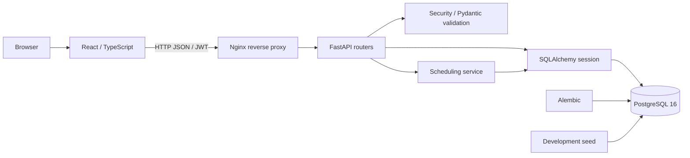

# Architecture blueprint — prototype baseline

| Component | Responsibility | Source |
|---|---|---|
| React pages | View state, input, filters and role-specific flows | frontend/src/pages |
| Auth context and UI guards | Token and user state; convenience checks | frontend/src/auth.tsx, components/Ui.tsx |
| FastAPI | Router boundaries, schema validation, authorization and business actions | backend/app/main.py, api, schemas.py |
| Scheduling | Shared validation, fee, locking and conflict handling | backend/app/services/scheduling.py |
| Persistence | ORM entities, session and transactional writes | backend/app/models.py, db |
| Migration | Reproducible versioned schema | backend/alembic/versions |
| Compose/Nginx | Local development runtime and reverse proxy | compose.yaml, frontend/nginx.conf |

## Integration view
A Sprint 2 deployment must register auth/sports/courts/bookings/notifications, plus explicitly selected admin capability if included. Fullstack entrypoint and App.tsx import Sprint 3 features; either scope the entrypoints and related navigation/seed to Sprint 2 or include every dependency and label the result full prototype. Do not create a fake Sprint 2 history. See [integration plan](SPRINT_2_INTEGRATION.md).

## Quality and risks
Access enforced server-side; no direct browser/database connection; scheduling safety depends on PostgreSQL and transaction design. SQLite fixture tests cannot prove GiST protection. No production infrastructure, actual payment provider or security certification. Review proposed decisions in ../adr. API interactions are indexed in ../../specs/API_CONTRACTS.md and sequence in ../../specs/diagrams/SEQUENCE_DIAGRAM.md.
