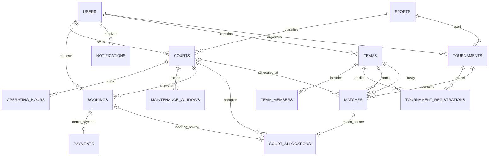

# Full physical ERD — migrations 0001 and 0002

The two optional source relationships on COURT_ALLOCATIONS are mutually exclusive: exactly one source must exist. The application creates one payment/allocation for each successful booking; DB relationships alone allow zero dependent rows. A match may have no court before scheduling. Migration 0002 adds nine tables to the five-table foundation; `alembic_version` is metadata, not a business entity.
