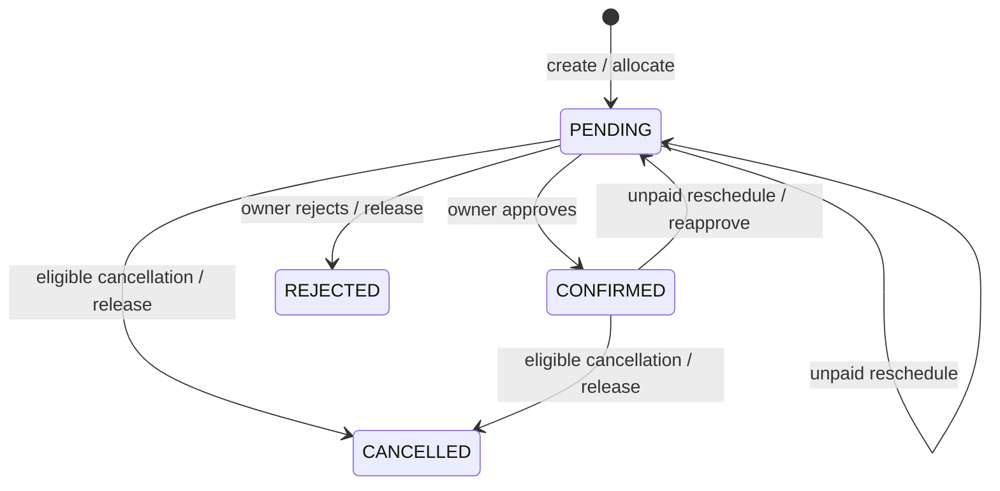
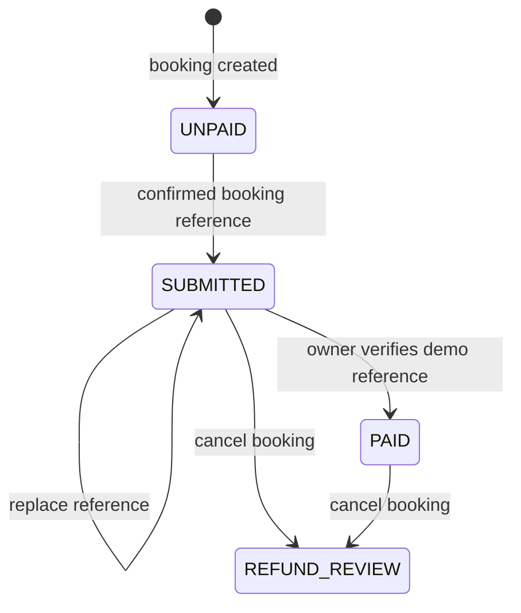
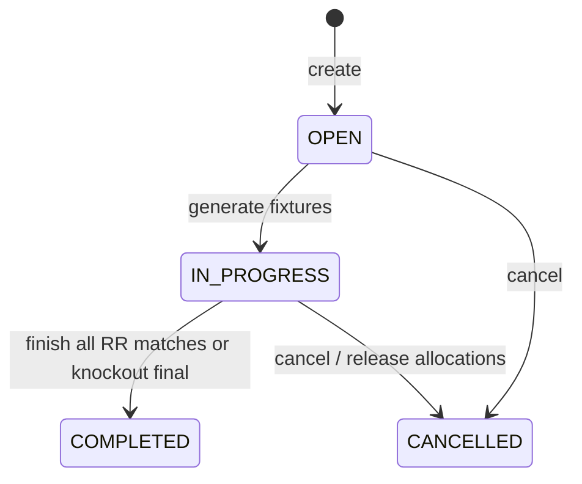

# State machines

## Booking (Sprint 2)

No automated COMPLETED or expiry transition is implemented in the inspected booking router. A past booking may retain CONFIRMED. Rejected/cancelled cannot be changed through the inspected action endpoints.

## Payment (separate machine)

Cancellation of an unpaid booking leaves payment UNPAID. PAID is simulation only.

## Tournament (Sprint 3 scope)

Registration: PENDING → APPROVED or REJECTED. Match: PLANNED → SCHEDULED → FINISHED; a scheduled match may be rescheduled; unfinished matches become CANCELLED when tournament is cancelled. Finished allocations are not explicitly released by scoring; the occupied time range remains recorded. The tournament status API also has a guarded manual COMPLETED request; review that path and the cancellation policy before acceptance.
