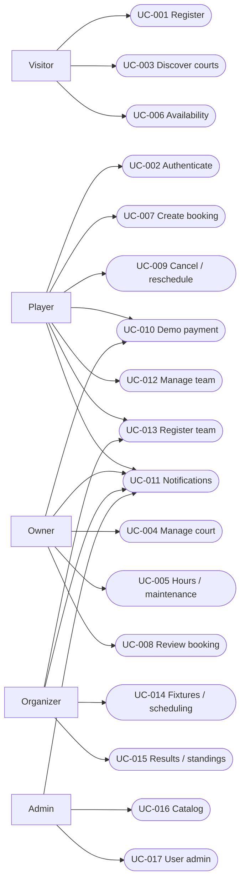

# Use case overview (actor-to-use-case map)

Mermaid flowchart notation is used for portability; this is a use-case overview rather than a formal UML diagram.

Admin may also perform explicitly authorized operations in individual use cases. The diagram omits repeated login associations for readability; the access matrix defines precise permissions.
